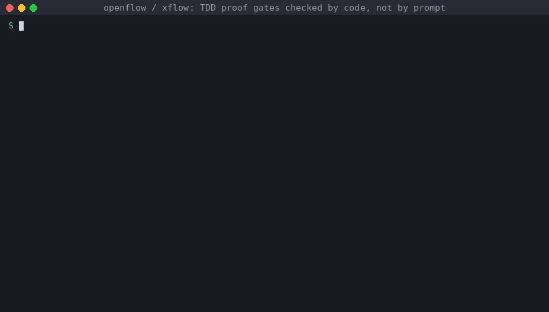

# OpenFlow

[](https://github.com/surlymochan/openflow/actions/workflows/ci.yml)
[](https://www.npmjs.com/package/@surlymochan/openflow)
[](LICENSE)


**Executable delivery workflow for AI coding agents.**

Prompt-based workflows *ask* an agent to write the failing test first, run the suite and keep notes. OpenFlow
*checks* that it did. Workflows are YAML phases made of small deterministic "atoms". Gates are code: a
red/green TDD proof, a test-quality review, artifact checks, and archive ordering. The `xflow` CLI runs the
same workflows from Codex, Claude Code, Cursor, OpenCode, Gemini or a plain terminal.



<sub>Recorded from a real run of the CLI in an empty project. The last two commands show an agent "recording" a
red proof after the fix, and the gate rejecting it.</sub>

## Why

Agent workflow kits are good at shaping behaviour, but the checks only live in prose. Agents skip the red
step, write tests that assert nothing, lose context between sessions, and open PRs before verification has
finished. OpenFlow adds a harder layer underneath:

- **Workflow as data.** `workflows/yolo.yaml` and `workflows/corps.yaml` are validated against an atom registry before they run.
- **TDD proof checked by code.**
  - The red proof must fail before implementation and the green proof must pass after it.
  - `I6c.tdd.quality_review` rejects code changes that have:
    - no meaningful test changes,
    - empty assertions,
    - snapshot-only tests,
    - mock-heavy tests without real assertions.
- **Context that survives sessions.**
  - The `.xflow/GOAL.md` project anchor.
  - `HANDOFF.md` and `AHA.md`.
  - Per-change `status.json` and proof files under `specs/changes/<id>/`.
- **Executable finish.** Verify → archive → commit/push → PR ordering is a tested atom, not a checklist.

## 3 Minute Start

Requires Node.js ≥ 22.5 (for `node:sqlite`) and Python 3 (atoms are small Python scripts).

```bash
npm install -g @surlymochan/openflow     # installs the `xflow` CLI
cd your-project
xflow init --project-root .               # writes .as-xflow/config.json
xflow goal set "Ship the next verified change" --project-root .
xflow goal audit --project-root . --json
xflow doctor --project-root .
xflow workflow validate yolo --project-root .
xflow guide                               # the delivery loop in one screen
```

For a source checkout:

```bash
git clone https://github.com/surlymochan/openflow.git
cd openflow
npm ci && npm test
node bin/xflow.js quickstart
node bin/xflow.js evaluate
node bin/xflow.js compare codex-goal
node bin/xflow.js launch copy
```

## Run a change

```bash
git checkout -b feat/example-change
xflow workflow run yolo \
  --title "Example change" --change-type backend \
  --tdd-red-command  "npm test -- --grep new-behavior" \
  --tdd-green-command "npm test"
```

The lite track runs `tdd-red -> execute -> tdd-green -> verify -> archive` and stops at human or LLM gates. Every
phase leaves evidence in `specs/changes/<change-id>/`. Add `--dry-run` to print the phases, atoms and gates
first.

You can also run a single gate directly, as in the demo:

```bash
xflow atom run I6a.tdd.run --change-id my-change --phase red   --test-command "npm test"
xflow atom run I6a.tdd.run --change-id my-change --phase green --test-command "npm test"
xflow atom run I6b.tdd.proof_validate --change-id my-change --phase red
```

## Evaluate it

```bash
xflow quickstart        # copy-paste-safe first-run commands
xflow evaluate          # one-shot brief: quality score, comparisons, blockers, next actions
xflow assess            # scorecard for goal, yolo, corps and the skill family
xflow score             # competitive readiness score with evidence per dimension
xflow demo launch       # goal -> yolo and goal -> corps proof paths
xflow launch dossier    # one-page narrative backed by the same audit
xflow launch copy       # claim-safe announcement copy plus forbidden phrases
xflow release status    # the single next release blocker
```

<details>
<summary>Release-owner gates (fail until real adoption / npm evidence exists)</summary>

```bash
xflow adoption trial --name <team-or-project> --source <tracker-or-pr> --track yolo
xflow adoption status --json
xflow package preflight --check-registry --check-auth --json
xflow package audit --check-registry --json
xflow launch audit --pre-publish --strict --json
```

</details>

## Choose a track

| Track | Use when | Entry |
| --- | --- | --- |
| `goal` | You want a project-level direction anchor that later work reads and audits | `xflow goal set`, `xflow goal audit` |
| `plan` | You only need a reusable implementation plan | `xflow:plan` skill |
| `yolo` | Backend, docs, infra, small UI; low ceremony | `xflow workflow run yolo` |
| `corps` | Product/UI-heavy or multi-agent work with governed proof | `xflow corps --explain`, then `xflow corps` and `xflow proof --track corps` |
| `ralph` | Keep implementing, verifying and repairing until the completion evidence is clean | `xflow:ralph` skill |

Not sure which one fits? Run `xflow intake recommend --change-id <id> --title "<title>" --description "<text>"`.

## How it fits together

```
workflows/*.yaml ──validate──► atoms/registry.json ──► xflow/atoms/*.py   (deterministic steps)
        │                                                    │
        ▼                                                    ▼
  xflow workflow run ──► gates: deterministic | artifact-verify | human | llm
        │
        ▼
  specs/changes/<id>/   status.json · tdd/red-0.json · tdd/green-0.json · quality-0.json · logs/*.ndjson
```

- `bin/xflow.js`: the CLI. `src/`: workflow loader, runner, policy overlays, scoring.
- `xflow/`: the portable skill family (`xflow:plan`, `xflow:yolo`, `xflow:corps`, `xflow:ralph`, …) for agent hosts.
- `schemas/`: JSON schemas for workflows, proofs and policy overlays.

## Compared with other tools

OpenFlow aims to complement prompt-level workflow kits and spec tools, not replace them. `xflow compare
<superpowers|openspec|gstack|spec-kit|codex-goal>` prints a side-by-side with sources.

<details>
<summary>Full capability table</summary>

| Surface | OpenFlow Position |
| --- | --- |
| Goal alignment | Project-level `.xflow/GOAL.md` that yolo, corps, Ralph, handoff, and takein consume |
| One-shot evaluation | `xflow evaluate` combines quality score, Codex goal / Superpowers / Super-Assistant comparison, ordinary and splash launch blockers, release-owner status, claim boundaries, next actions, and first-run path |
| Quality assessment | `xflow assess` gives a public scorecard for goal, yolo, corps, and the skill family |
| Launch demo | `xflow demo launch` shows goal -> yolo and goal -> corps proof paths |
| Launch audit | `xflow launch audit` separates ready engine and adoption evidence from missing registry proof |
| Launch dossier | `xflow launch dossier` prints the one-page public narrative backed by the same audit payload |
| Launch claims | `xflow launch claims` separates what can be said publicly now from claims blocked by missing evidence |
| Launch copy | `xflow launch copy` generates claim-safe announcement copy and forbidden phrases from the same evidence |
| Package status | `xflow package status` gives a non-failing publish/install status summary |
| Package audit | `xflow package audit` validates public npm registry evidence before splash-launch claims |
| Release status | `xflow release status` gives the release owner one focused blocker, next action, package status, and handoff doc |
| Adoption status | `xflow adoption status` gives a non-failing ordinary/splash adoption blocker summary |
| Adoption trial | `xflow adoption trial` gives external teams the exact commands and evidence checklist before a trial packet is written |
| Publish handoff | `docs/npm-publish-handoff.md` records the exact auth, preflight, publish, and post-publish gates |
| TDD | Executable red/green proof plus quality review |
| Workflow | YAML phases validated against atom registry |
| Spec migration | OpenSpec mapping report plus deterministic `spec_delta_review.json` |
| Local closure | Doctor, drift scan, release pack, archive ordering |
| Team handoff | `HANDOFF.md`, `AHA.md`, reviewer guide |
| Team adoption | Role model, CI boundary, PR acceptance, release ownership |
| Cross-tool use | Plain CLI and skill docs for Codex, Claude Code, Cursor, OpenCode, Gemini |
| Competitive proof | `xflow compare codex-goal`, `xflow compare superpowers`, `xflow compare super-assistant`, `xflow compare openspec`, `xflow compare gstack`, `xflow compare spec-kit`, benchmark docs |
| Adoption proof | Minimal clean project runs in CI, plus public adoption-record templates |

</details>

## Docs

<details>
<summary>All guides</summary>

- [Quickstart](docs/quickstart.md)
- [Install and upgrade](docs/install-upgrade.md)
- [Tooling matrix](docs/tooling-matrix.md)
- [Compatibility notes](docs/compatibility.md)
- [Demo proof](docs/demo-proof.md)
- [Examples gallery](docs/examples-gallery.md)
- [Public benchmark](docs/public-benchmark.md)
- [Quality assessment](docs/quality-assessment.md)
- [Launch demo](docs/launch-demo.md)
- [Launch dossier](docs/launch-dossier.md)
- [Corps operator guide](docs/corps-operator-guide.md)
- [Superpowers comparison](docs/superpowers-comparison.md)
- [Super-Assistant comparison](docs/super-assistant-comparison.md)
- [Adoption evidence template](docs/adoption/README.md)
- [Maintainer adoption record](docs/adoption/openflow-release-hardening.md)
- [xflow Goal vs Codex native goal](docs/goal-vs-codex.md)
- [Walkthrough](docs/walkthrough.md)
- [OpenSpec migration](docs/openspec-migration.md)
- [spec-kit benchmark](docs/spec-kit-benchmark.md)
- [Integration matrix](docs/integrations.md)
- [Public release gate](docs/public-release.md)
- [npm publish handoff](docs/npm-publish-handoff.md)
- [Release notes](RELEASE_NOTES.md)
- [Adapter fixture](docs/fixtures/tracker-item.json)
- [Methodology](docs/methodology.md)
- [Reviewer guide](docs/reviewer-guide.md)
- [Team adoption operating model](docs/team-adoption.md)
- [Competitive benchmark](docs/competitive-benchmark.md)
- [2026-05-25 benchmark report](docs/benchmark-openflow-vs-gstack-superpowers-openspec-2026-05-25.md)

</details>

## Development

```bash
npm ci
npx playwright install chromium   # browser-evidence tests
npm test                          # 270+ tests
npm run drift:scan                # docs/skill/workflow drift checks
npm run pack:check                # what would be published
```

Contributions are welcome: open an issue describing the workflow problem first, then a PR with tests. Keep
claims in docs tied to a command that reproduces them.

## License

[MIT](LICENSE)
